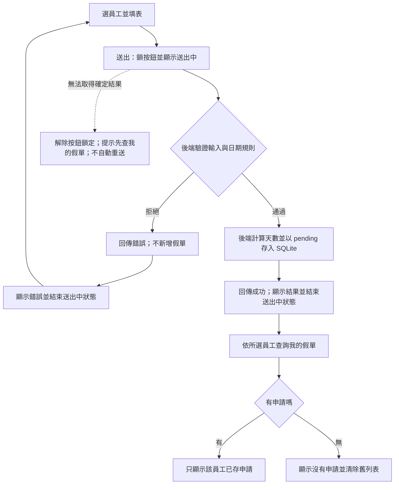

# 03 SRS — LeaveBot 請假系統

- 版本：0.3；日期：2026-11-01。
- 狀態：理由上限變更已確認；新提交 100 碼位規格待 002 實作，程式目前仍為 200。
- 審查者／產品決策人：小組使用者代表；未決交講師。
- 來源：[PRD](02-prd.md)、[Brief](01-brief.md) D-01～D-03、[課程題目](../course/01-上課/03-LEAVEBOT.md)、[STACK](../course/01-上課/04-STACK.md)。
- 變更紀錄：0.1 首次承接既有 AC；不修改上游文件，不新增產品決策。本文件尚無執行或驗收證據。
- 0.2：依使用者確認同步 PRD，解決字數與網路中斷規則；保留原 AC／FR 編號。
- 0.3：依使用者確認將新提交理由上限改為 100；舊 101–200 碼位理由保留，SQLite 儲存上限維持 200，不遷移或截斷資料。保留原編號，尚未驗證新規格。

## 功能需求

| ID | 可觀察的系統行為 | 來源 AC |
|---|---|---|
| FR-01 | 提供員工名單供下拉選擇；後端檢查員工、假別、開始日期、結束日期、時段必填，員工須存在，假別與時段須合法；不合法時拒絕且不新增假單。 | AC-01.1、AC-02.1 |
| FR-02 | 新提交理由選填，去除前後空白後按 Unicode 碼位計數，最多 100；中間空白計入，只含空白視為未填，不作組合正規化。超長拒絕且資料不變；既有 101–200 碼位理由保留原文，查詢／顯示不套新提交驗證。 | AC-01.1、AC-02.2、AC-03.1 |
| FR-03 | 接受過去日期；後端驗證結束日期不得早於開始日期，反向日期拒絕且不新增。 | AC-01.2、AC-02.3 |
| FR-04 | 後端依含首尾的日期範圍計算週一至週五；整天每工作日 1 天，上午／下午限單一工作日且為 0.5 天；半天跨日或零工作日拒絕且不新增。 | AC-01.1、AC-02.3 |
| FR-05 | 全部驗證通過才在 SQLite 新增申請；保存所選員工、合法輸入、後端計算天數與後端固定的 `pending`，成功後顯示成功並可在我的假單查到。客戶端提供的天數與狀態不得成為可信存檔值。 | AC-01.1、AC-01.2、AC-02.3、AC-03.1 |
| FR-06 | 送出開始後至取得結果前鎖按鈕並顯示「送出中」，連點不產生額外請求；取得結果後結束送出中狀態並顯示結果。網路中斷而無法確認結果時解除按鈕鎖定，顯示「無法確認是否送出成功，請先查看我的假單，再決定是否重送」，不自動重送或推定未存檔。 | AC-01.3 |
| FR-07 | 每次獨立送出的合法申請均可新增；不因內容與既有申請相同而拒絕、合併或自動去重。 | AC-01.4 |
| FR-08 | 後端驗證拒絕時提供可理解的錯誤供畫面顯示，假單筆數不增加；修正後可再送出，僅合法送出新增資料，原拒絕輸入不產生假單。 | AC-02.1、AC-02.2、AC-02.3、AC-02.4 |
| FR-09 | 我的假單只查詢並顯示所選員工的申請及規定欄位；切換員工不得沿用其他員工列表；重新整理後選回同一員工，仍能查到已保存資料。 | AC-03.1 |
| FR-10 | 所選員工沒有申請時，明確顯示目前沒有申請，清除先前員工列表；查詢本身不新增假單。 | AC-03.2 |

## 規則與資料字典

前端收集輸入，後端驗證後才計算並存檔；不得以畫面驗證代替後端驗證。全部規則通過才進入新增流程，驗證拒絕不得留下假單。API 路徑、傳輸欄位名稱、錯誤碼與資料表結構留待設計，不在本文件先定。

### 使用者可控輸入

| 項目 | 必填／合法值與邊界 | 缺漏或無效結果／FR |
|---|---|---|
| 員工 | 必填；識別值必須存在於提供的員工名單；顯示名稱不取代存在性檢查。具體名單未指定。 | 拒絕、不新增／FR-01、FR-08 |
| 假別 | 必填；僅 `annual`（特休）、`personal`（事假）、`sick`（病假）。 | 拒絕、不新增／FR-01、FR-08 |
| 開始與結束日期 | 兩者必填且為有效日曆日期；結束不得早於開始；接受過去日期。日期作日曆日計算，不以經過幾小時換算天數。 | 缺漏、無效或反向則拒絕、不新增／FR-01、FR-03、FR-08 |
| 時段 | 必填；整天、上午、下午。傳輸代碼留待設計；其他選項非法。 | 拒絕、不新增／FR-01、FR-04、FR-08 |
| 理由（新提交） | 選填，空值合法；去除前後空白後按 Unicode 碼位計數，最多 100；中間空白計入，只含空白視為未填；保存處理後文字，不作組合正規化。既有理由查詢不重驗新上限。 | 超長拒絕、資料不變／FR-02、FR-08 |

「必填」禁止缺少值或空值；理由依 FR-02 去除前後空白，其他欄位不因此套用理由處理規則。無論前端是否阻擋，繞過前端送入不合法資料時仍須由後端拒絕。理由中看似程式或 HTML 的內容僅為文字，不執行、不作 HTML 渲染（FR-02、NFR-01）。

### 後端決定的資料與計算

- 天數（FR-04、FR-05）：令 W 為開始至結束日期間（含首尾）的週一至週五數量，不另扣國定假日。整天為 W 天；上午或下午需開始＝結束且 W＝1，結果為 0.5 天。W＝0 一律拒絕；反向日期先依 FR-03 拒絕，不將它當成零工作日。
- 狀態（FR-05）：新增時只能是 `pending`，畫面顯示「待審核」；申請成功不等於核准。客戶端指定其他狀態或天數不得覆蓋後端結果。額外欄位採拒絕或忽略的介面策略留待設計明定；兩者都必須維持此不變條件。
- 持久內容（FR-05、FR-09）：員工歸屬、假別、開始日期、結束日期、時段、理由、計算天數與狀態；重新整理後不依賴先前頁面記憶才能查回。
- 列表（FR-09、FR-10）：顯示所選員工申請的假別、日期、時段、理由、天數與狀態；查詢按員工歸屬限制，不將所有員工資料混入結果。未指定排序，不把某種順序當成已確認承諾。無登入，因此此隔離不是身分授權保證。
- 重送（FR-06、FR-07）：同一次進行中的操作鎖按鈕；完成後的新送出獨立驗證並可另建假單。無跨請求去重保證；連線失敗也不能推定未存檔。

### 可獨立核算的邊界與反例

除特別標示外，以下各例使用名單內員工、合法假別與合法理由，每列獨立驗證；「拒絕」均須有可理解錯誤且假單筆數不增加。

| 輸入 | 預期結果 | 對應 |
|---|---|---|
| 2026-10-12（一）當日整天、理由留空 | 成功，1 天，`pending` | FR-02、FR-04、FR-05／AC-01.1 |
| 今天固定 2026-10-14，申請 2026-10-12 當日整天 | 成功，1 天，不因過去日期拒絕 | FR-03／AC-01.2 |
| 2026-10-09（五）至 2026-10-12（一），整天 | 成功，2 天；六、日不計 | FR-04／AC-02.3 |
| 2026-10-12 當日，上午、下午分別送出 | 各成功，0.5 天 | FR-04／AC-02.3 |
| 開始 2026-10-13，結束 2026-10-12，整天 | 拒絕：日期反向 | FR-03／AC-02.3 |
| 2026-10-12 至 2026-10-13，上午、下午分別送出 | 各拒絕：半天跨日 | FR-04／AC-02.3 |
| 2026-10-10（六）至 2026-10-11（日），整天 | 拒絕：W＝0 | FR-04／AC-02.3 |
| 2026-10-10 當日，上午、下午分別送出 | 各拒絕：非工作日 | FR-04／AC-02.3 |
| 任一必填缺漏、不存在的員工、其他假別或時段（各別送出） | 各拒絕；不是只測畫面阻擋 | FR-01、FR-08／AC-02.1 |
| 新提交理由為「假」重複 100 次 | 成功保存 100 碼位 | FR-02／AC-02.2 |
| 新提交理由為「假」重複 101、200、201 次（分別驗證） | 各拒絕且資料不變；提示理由最多 100 字 | FR-02、FR-08／AC-02.2 |
| 變更前已有 200 碼位理由，啟動及查詢後 | 原文、id、其他欄位與筆數均不變，仍可查看 | FR-02、FR-09／AC-02.2、AC-03.1 |
| 完成後再次送出同一合法內容 | 另新增一張 `pending` | FR-07／AC-01.4 |
| A、B 各有申請，C 無申請；依序選 A、B、C | 分別只見 A、只見 B、明確空列表；查詢不新增 | FR-09、FR-10／AC-03.1、AC-03.2 |

## 品質需求

- NFR-01｜文字與資料安全：理由包含 `<b>請假</b>` 等 HTML 外觀內容時，只顯示文字，不產生對應 HTML 元素或執行腳本；SQL 使用參數，使用者文字不得成為 SQL 指令。驗證：後續安全輸入案例、畫面操作及程式審查。來源：課程題目、AGENTS.md、PRD 產品規則；關聯 FR-02、AC-03.1。
- NFR-02｜持久性與拒絕無新增：驗證拒絕前後查詢資料，假單筆數不變；合法新增後重新整理並選回該員工，保存欄位仍一致。驗證：暫存資料庫的前後核對及人工重新整理。關聯 FR-05、FR-08、FR-09；來源 AC-01.1、AC-02.1～AC-02.4、AC-03.1。
- NFR-03｜可重現驗證：自動化測試使用暫存資料庫及明確固定的時鐘，不讀寫開發資料庫；過去日期案例可用今天 2026-10-14 與申請日 2026-10-12 重做。驗證：測試設定與執行紀錄。來源 STACK、AGENTS.md；關聯 AC-01.2。
- 效能：目前無量測或業務依據，不指定回應秒數、吞吐量或並行人數門檻，留待有執行環境後量測；不以「快速」作為驗收承諾。

## 流程與未決事項

現有 diagrams/submit-leave.html 與候選檔為 v0.2 歷史圖，卡片仍寫 200；流程拓樸不變，不能當作 v0.3 上限說明。002 實作交付時同步卡片並依 Archify 重驗；本輪不改 HTML 或工具證據。

### 矛盾與決策紀錄

核心業務規則未發現題目與 PRD 相互矛盾。使用者於 2026-11-01 確認兩項補充建議，以及合法存為待審核／非法不存檔、半天與扣週末、所選員工列表及持久性三個核心重點。本次同步 PRD 與 SRS，無阻塞規格的待決產品問題；文件確認不代表實作通過。

| 原問題 | 已確認結果與可核算例子 | 對應 |
|---|---|---|
| OQ-01（已解決） | 去除理由前後空白後按 Unicode 碼位計數，中間空白計入，只含空白視為未填；保存處理後文字，不作組合字元正規化。` 請 假 ` 保存為 `請 假`（3）；`😀` 為 1；`e` 加 U+0301 為 2；`👩‍💻` 含 U+200D 共 3。前後端須一致，不按 UTF-16 單元或肉眼字形計數。 | FR-02／AC-02.2 |
| OQ-02（已解決） | 網路中斷而結果未知時解除按鈕鎖定，顯示「無法確認是否送出成功，請先查看我的假單，再決定是否重送」，不自動重送；不將此情境當作後端拒絕或未存檔證據。 | FR-06／AC-01.3 |

具體員工名單為後續資料依賴，A／B／C 是測試代稱；設計與測試時須提供明確可重現的名單，不虛構真實員工。日期計算使用日曆日，不涉及依時區判斷是否過期；驗收時的「今天」僅為補登案例的固定背景。

### AC 追溯與人工審查 Gate

| PRD AC | 承接 FR／NFR | 覆蓋狀態（非測試結果） |
|---|---|---|
| AC-01.1 | FR-01、FR-02、FR-04、FR-05；NFR-02 | 已承接 |
| AC-01.2 | FR-03、FR-05；NFR-03 | 已承接 |
| AC-01.3 | FR-06 | 已承接，含網路中斷結果未知回饋 |
| AC-01.4 | FR-07 | 已承接 |
| AC-02.1 | FR-01、FR-08；NFR-02 | 已承接 |
| AC-02.2 | FR-02、FR-08；NFR-02 | 已承接，含前後空白與 Unicode 碼位計數 |
| AC-02.3 | FR-03、FR-04、FR-05、FR-08；NFR-02 | PRD 每列日期例子均已承接 |
| AC-02.4 | FR-08、FR-05；NFR-02 | 已承接 |
| AC-03.1 | FR-02、FR-05、FR-09；NFR-01、NFR-02 | 已承接 |
| AC-03.2 | FR-10 | 已承接 |

- 完全未被 SRS 承接的 AC：無。OQ-01、OQ-02 均已解決，無因這兩項問題而無法獨立判定的規則。
- 後續依規格核對：必填與合法值、所有日期／半天例子的預期、客戶端不可決定天數與狀態、列表依員工隔離、拒絕無新增，以及已確認的理由與網路中斷規則。
- 本階段停止條件：不超過 10 項 FR 且每項引用 AC、所有 AC 有追溯、確認決策留痕。此版已依使用者確認更新，尚未執行測試；不建立設計文件、不寫程式。
