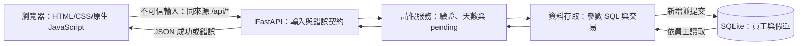

# 04 SAD — LeaveBot 請假系統

- 版本：0.2；日期：2026-11-01；狀態：理由變更設計已確認，待 002 實作／驗證；既有架構不變。
- 審查者：小組使用者代表；課程邊界爭議由講師決定。
- 上游：[PRD](02-prd.md)、[SRS v0.2](03-srs.md)、[固定技術](../course/01-上課/04-STACK.md)、[提交流程](../diagrams/submit-leave.html)。流程依本次指示作為設計輸入，工具檢查通過不代表功能已實作。
- 接縫與資料契約：[SDS](05-sds.md)。本次不修改需求或流程圖。

## 情境與品質驅動

員工選擇身分並送出請假，後端驗證、計算天數，存為待審核，再依所選員工列出申請。拒絕輸入不得新增資料（NFR-02）；理由含使用者文字，須以純文字顯示並使用參數 SQL（NFR-01）。測試必須隔離開發資料並固定時鐘（NFR-03）。

本次僅在本機課堂環境執行，單一 FastAPI HTTP 服務提供頁面與 API，SQLite 為本機檔案。理由可能包含個人資訊，主線沒有登入與身分授權，不適用真實敏感人事資料。正式部署不在範圍，不聲稱具備上線、負載或復原能力。

## 元件與資料流

瀏覽器與後端是信任邊界；畫面可輔助驗證，但不能決定天數、狀態或員工合法性。API 先拒絕格式錯誤與未知欄位，服務查員工存在性並驗證日期、理由、時段，程式計算天數；全部通過才新增並提交。成功回應只能在提交後產生。讀取使用員工條件，前端再避免切換員工時舊請求覆寫新列表。

資料庫例外回傳通用錯誤，不洩漏 SQL、理由或本機路徑。已確定回滾的寫入故障可說未保存；提交結果無法確認或回應中斷時，只能提示先查假單，不自動重送。列表讀取失敗顯示讀取失敗，不能當成空列表。

| 元件 | 責任／擁有資料 | 失敗時怎麼處理 |
|---|---|---|
| 靜態頁 `static/` | 欄位、送出鎖、結果、所選員工列表；FR-06、09、10 | 解鎖並依確定錯誤或未知結果提示，不自動重送。 |
| `main.py`、`api.py`、`schemas.py` | 應用組裝、JSON 型別與未知欄位、HTTP 錯誤；FR-01、05、08 | 統一錯誤結構，API 不落入靜態頁。 |
| `leave_service.py`、`rules.py` | 業務驗證、理由處理、工作日、固定 pending；FR-01～05、07、08 | 業務錯誤在寫入前回傳。 |
| `repository.py`、`db.py` | 員工與假單讀寫、交易、初始化與連線關閉；FR-05、09、10、NFR-01、02 | 回滾未提交交易；區分確定失敗與提交結果未知。 |
| `settings.py`、`clock.py` | 資料庫位置與可注入今天；NFR-03 | 不合法設定啟動失敗，不悄悄改用開發資料庫。 |

同來源、無 CORS；API 先登記，最後才掛 `/` 靜態頁。`/api` 未知路徑須回 JSON 404，不回 HTML。各元件屬同一 Python 程式，不拆成多個服務。

## 重要決策與取捨

固定技術直接沿用 STACK，不另立選型 ADR。

### ADR-01｜提交欄位採白名單，未知欄位拒絕

決定：包含客戶端 `days`、`status` 在內的未知欄位，以 422 拒絕且不新增。合法提交仍由後端算天數並設 `pending`，符合 SRS 允許設計選擇拒絕或忽略的邊界。

替代：忽略未知欄位，對舊客戶端較寬容，但容易隱藏欄位拼錯與前後端契約不一致。本課選明確拒絕，代價是未來加欄位需同步介面；可在契約修訂與測試更新後調整。

驗證：額外送入 `days`、`status` 或拼錯欄位，各得到指定錯誤且資料不增加；不是以客戶端指定值存檔。

### ADR-02｜以整數半天單位保存計算結果

決定：資料庫保存 `day_units`，1 單位＝0.5 天；API 輸出 `days = day_units / 2`。替代為直接保存實數天數；本題只有 0.5 與整數，兩者均可用，整數約束更容易核對與限制非法值。代價是讀寫需轉換；不增加使用者可選粒度。若未來改小時計假，須另定規格及遷移，不能直接沿用此單位。

驗證：半天保存 1、回傳 0.5；週五至週一整天保存 4、回傳 2。計算仍依 SRS，不讀客戶端天數。

## 運作、風險與未決

### ADR-03｜新提交 100，上限不追溯刪改舊假單

2026-11-01 使用者確認：新提交由後端強制理由最多 100 碼位；SQLite 仍維持儲存上限 200，既有 101–200 碼位資料可原樣查閱，不截斷或刪除，無須 schema 遷移。新建與既有 DB 使用同一 schema，避免初始化時偷偷改既有表。

替代是把 DB CHECK 也改 100；這會遇到舊資料不符合限制，需額外遷移／歷史辨識策略，若直接截斷會破壞原申請。本票採保留儲存相容性，代價是 100 的新提交規則依賴服務入口強制，DB 的 200 只是歷史儲存限制，不能宣稱 DB 本身保證 100。

驗證：新提交 100 成功、101／200／201 拒絕且資料不變；以暫存舊 DB 讀回 200 碼位理由，重啟後原文不變。實作僅更新驗證與提示，讀取路徑不得重新正規化或截斷舊資料。本設計尚未實測。

- 啟動：依 STACK 使用 Python 3.12 與虛擬環境；建立 app 時讀設定，lifespan 初始化表與範例員工，再接受請求。不能在 import 時連開發資料庫；未初始化成功則啟動失敗。
- `LEAVEBOT_DB` 預設為以專案根目錄定位的 `backend/data/leavebot.db`，不依啟動目錄漂移；測試明確傳入暫存路徑。時鐘從 `LEAVEBOT_TODAY` 或真實本機日期建立，測試可直接注入固定日期。詳見 SDS。
- 每請求獨立連線；不共用跨執行緒連線；提交完成才回 201；失敗回滾並關閉。重複內容沒有唯一限制，也沒有自動重送。
- 記錄伺服器端錯誤代碼、HTTP 路徑與例外類型；不記錄完整提交內容、理由或秘密。用戶只見安全訊息，無效 API 請求不產生資料。
- 本機備份：停止應用並確認所有連線已關閉後，另存 SQLite 檔案；恢復時在停機狀態更換備份並重新啟動。這是操作設計，尚未演練，不納版控，不承諾復原時間。
- 正式部署／正式發布回退：不適用，本課只在本機執行。上線前另補登入授權、隱私與保留政策、備份演練、遷移策略、容量與效能量測；不以課堂限制當成安全保證。
- 未決核心產品規則：無。SDS 的範例員工為教學資料；正式名單不在本次範圍。設計仍待小組審查，測試與人工驗收尚未進行。

審查結論：責任、信任邊界與失敗回饋均有落點；FR／NFR 對照列於 SDS。未新增核准、額度、登入或 LLM。
